# Cyan Arcade

[](https://github.com/trannguyendangtam1111/cyan-arcade/actions/workflows/backend-ci.yml)

**Cyan Arcade is a full-stack browser arcade with player accounts, leaderboards, a coin economy, a shop, and server-side trading-card pack opening.** The backend uses Java 21, Spring Boot and PostgreSQL; the client uses React and TypeScript.

This portfolio project focuses on backend problems shared by business applications: protecting account access, validating client input, maintaining balances and inventory under concurrency, and making retried operations safe. It is implemented as a modular monolith with shared platform services and separate game modules.

[Run locally](#getting-started) · [Engineering challenges](#backend-engineering-challenges) · [Architecture](ARCHITECTURE.md#backend) · [API reference](API.md) · [Tests and CI](#testing)

## Backend Engineering Highlights

- **Java 21 and Spring Boot 4:** REST controllers, Bean Validation, service-layer transactions, Spring Data JPA and `JdbcClient`, with consistent RFC 9457 Problem Details responses.
- **Modular architecture:** packages organized by feature, service/DTO boundaries, package-private persistence classes, and ArchUnit rules against dependency cycles and controller access to persistence.
- **Authentication and authorization:** Spring Security sessions, bcrypt password hashing, `HttpOnly` cookies, CSRF protection, and USER/ADMIN authorization at the HTTP and method levels.
- **PostgreSQL and Flyway:** versioned migrations, foreign keys, unique/check constraints and leaderboard indexes. Hibernate validates the schema; Open Session in View is disabled.
- **Transactional integrity:** wallet row locks, pessimistic game-session locks and pack-opening advisory locks coordinate concurrent requests. Coin changes are recorded in an auditable ledger alongside balance updates.
- **Idempotency:** client request IDs prevent repeated shop purchases. Pack opening stores a response snapshot with a unique user/request key, replays successful retries, and rejects reuse for a different pack.
- **Secure configuration and abuse protection:** admin seeding requires explicit opt-in and credentials; bounded request limits protect registration, login and game-session creation. Forwarded headers require an explicitly trusted proxy deployment.
- **Automated verification:** JUnit, MockMvc, PostgreSQL Testcontainers and ArchUnit. The [GitHub Actions workflow](.github/workflows/backend-ci.yml) runs Maven `verify` on Java 21 and uploads available test and JaCoCo reports, including after test failure.

## Screenshots

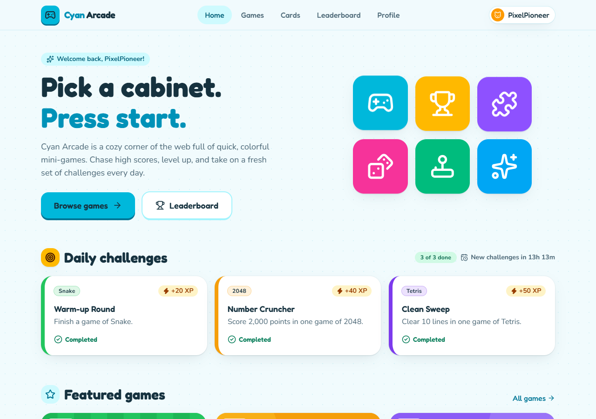

| | |
| --- | --- |
| 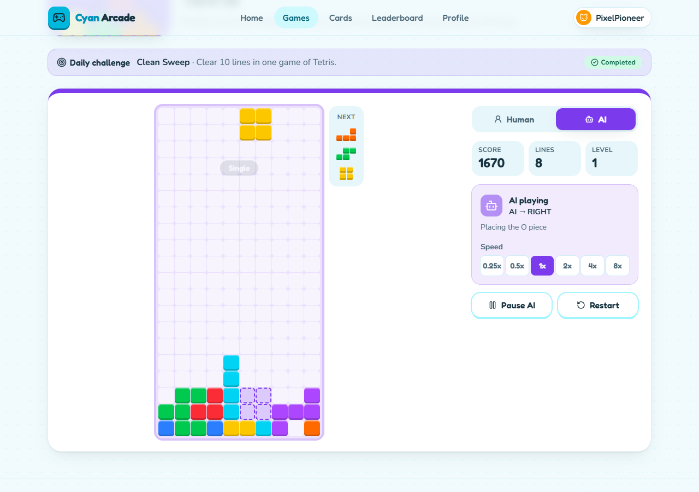 | 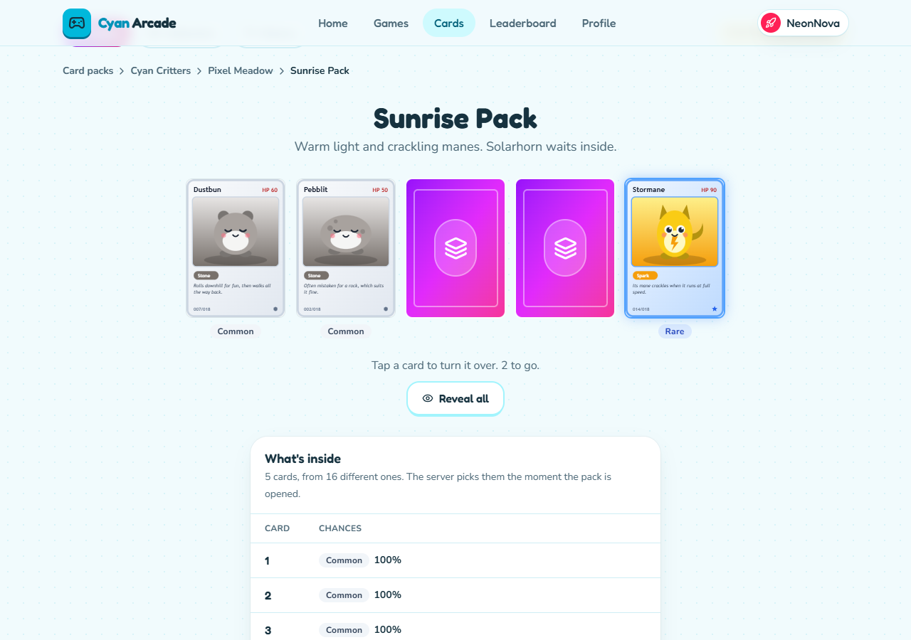 |
| Tetris AI mode, available to admins | Packs of real cards, opened on the server and revealed one card at a time |
| 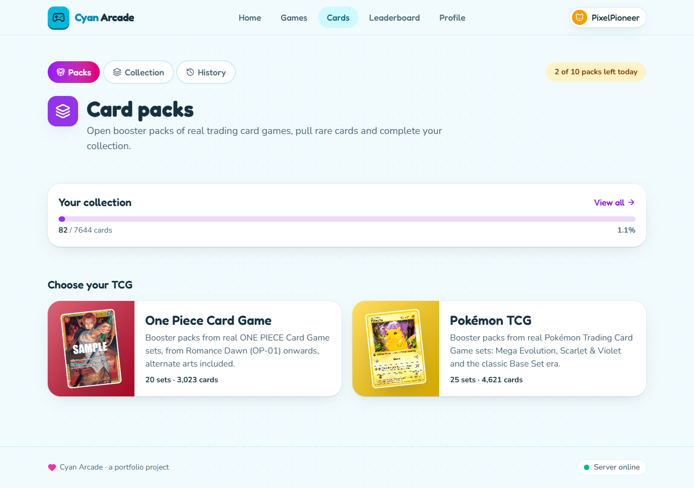 | 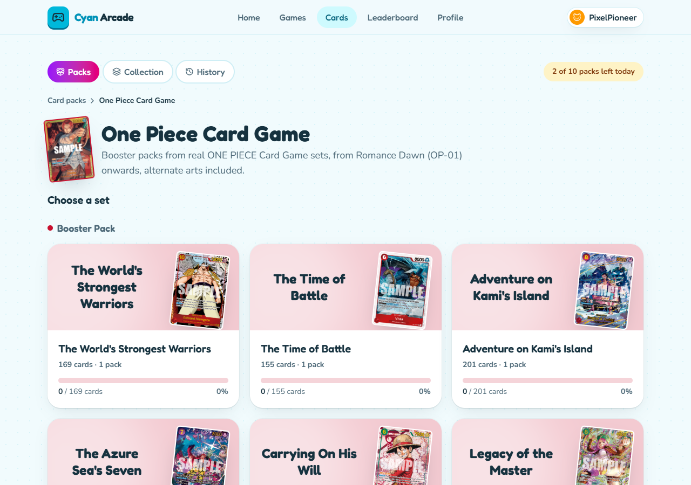 |
| Pokémon and One Piece, each in its own color | Real sets, shown by their logo or one of their rarest cards |
| 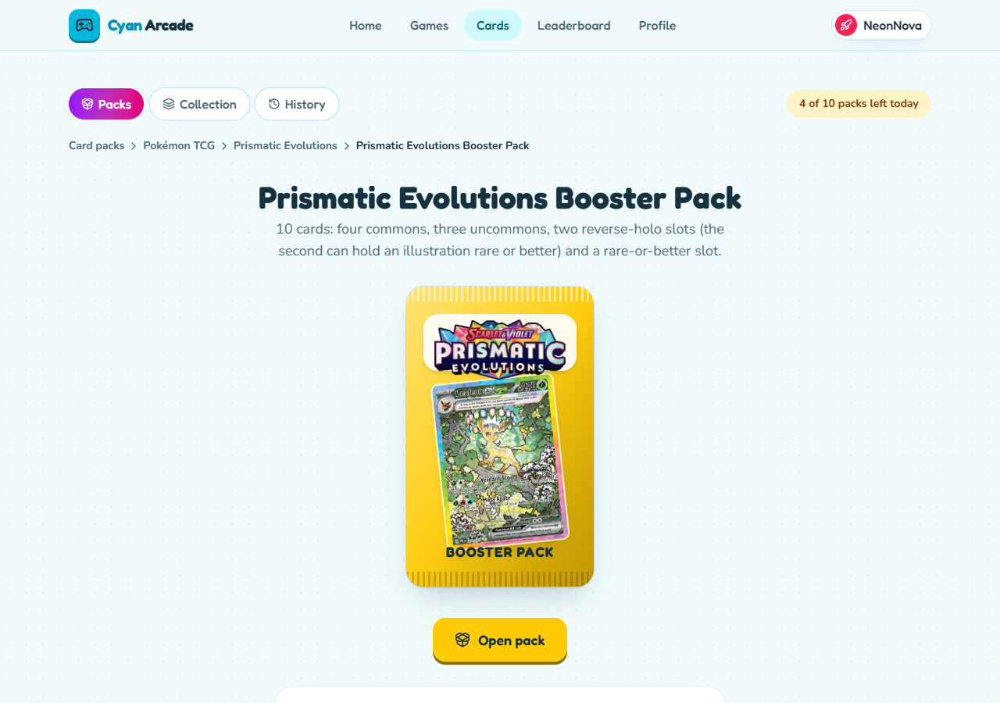 | 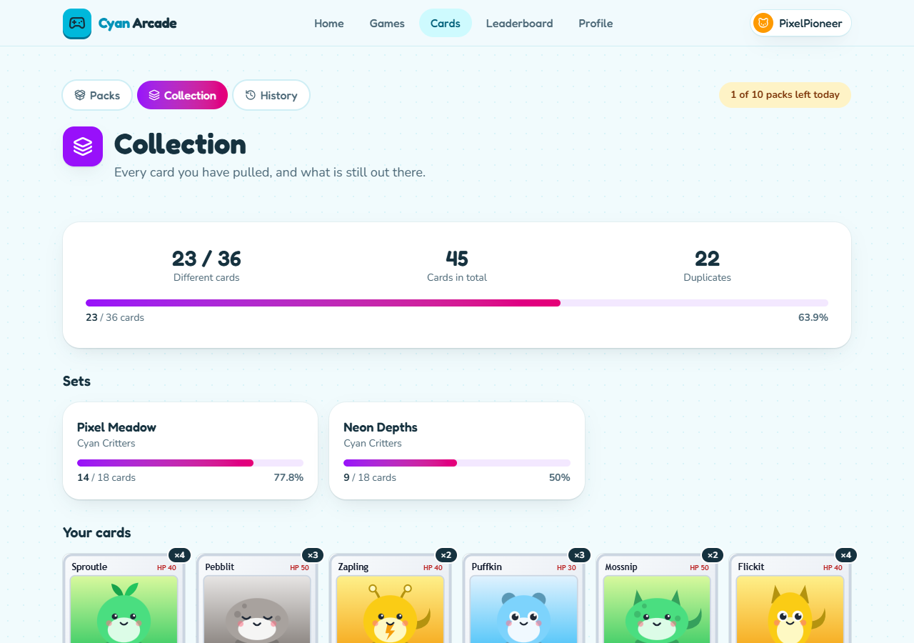 |
| Every pack publishes its odds, and says they are a simulator's | The collection, by game and set |
| 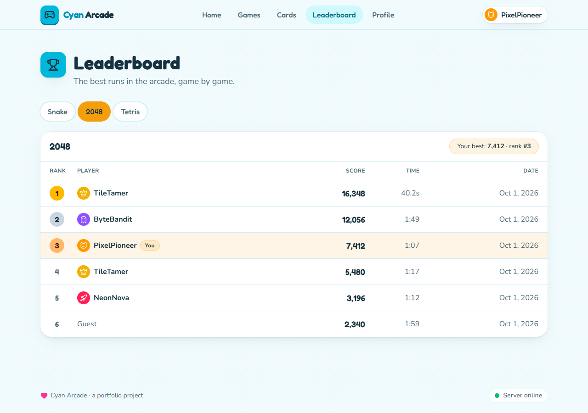 | 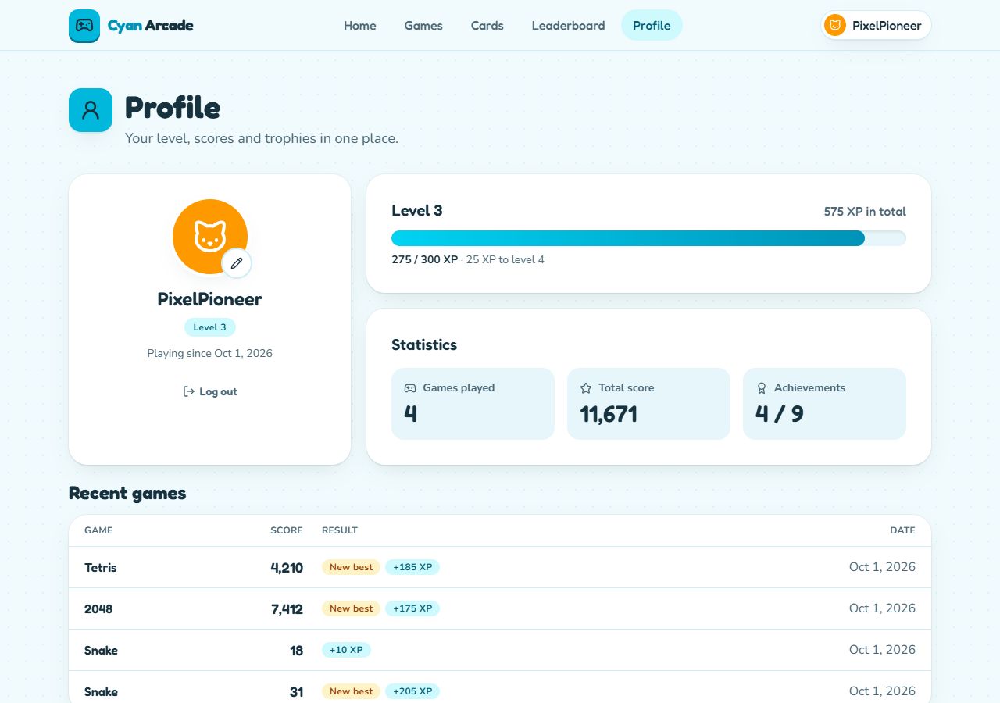 |
| Leaderboards with names, avatars and your own rank | Level, statistics, history and achievements |
| 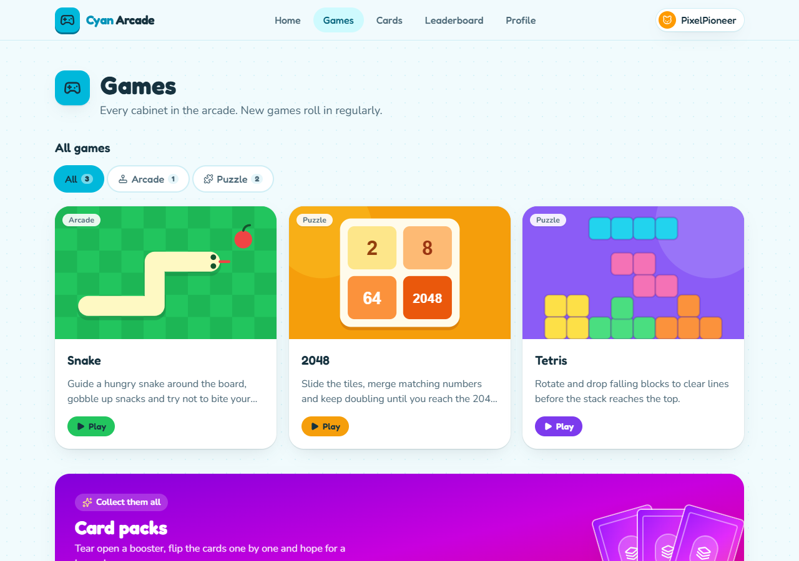 | |
| The catalog, filterable by category, and the way into card packs | |

<p>
  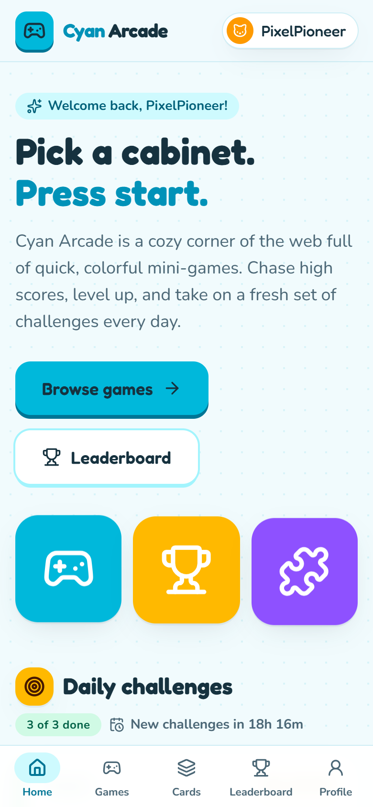
  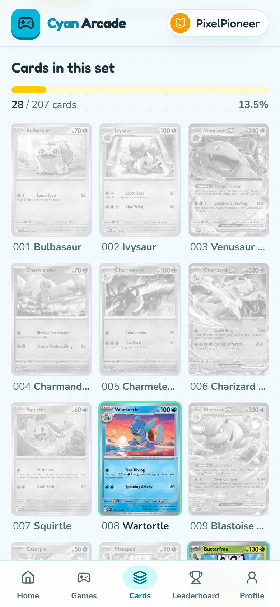
</p>

## Status

The implemented platform includes accounts and roles, scored game sessions, progression, daily challenges, purchases, card collections and opening history. Docker configuration and backend CI are included. Hosted HTTPS deployment, persistent login sessions, password reset and online Chess remain [planned work](#roadmap).

For verification results, inspect the [CI runs and report artifacts](https://github.com/trannguyendangtam1111/cyan-arcade/actions/workflows/backend-ci.yml). No fixed test count or coverage percentage is claimed here; results depend on the revision and checks actually run.

## Features

### Games

- **Arcade games:** Snake, 2048, Tetris, Minesweeper, Flappy Bird, Brick Breaker and Dino Run, with keyboard/touch controls and game-specific score checks. Selected games include admin-only algorithmic AI modes.
- **Word Guess:** daily and practice puzzles; the backend keeps the answer and judges guesses, hints and scoring.
- **Sudoku:** daily and practice puzzles with unique solutions, difficulty grading, server-validated moves and server-timed ranked runs.
- **Chess:** server-enforced rules for local two-player games, plus Stockfish hints and Coach Mode for signed-in players; engine games, analysis and reviews for admins. Chess is unscored and has no online multiplayer yet.
- **Shared client features:** responsive layouts, light/dark themes, game skins and accessible keyboard controls. Game design and extension details are in [ARCHITECTURE.md](ARCHITECTURE.md#how-to-add-a-new-game).

### Platform

- Accounts with USER/ADMIN roles, editable identities, public profiles and an admin dashboard.
- Daily, weekly and all-time leaderboards with deterministic ranking and each player's best score.
- XP, levels, achievements, daily challenges and a daily login reward, using the server's UTC date.
- A coin economy with transaction history; a shop for extra packs, badges, titles, profile frames and game skins; inventory and equipment rules enforced on the backend.
- Guest play, with an account required to earn rewards, buy items and collect cards.

### Trading-card packs

- Pokémon and One Piece catalogs imported into PostgreSQL; browsing and opening packs do not call the external data APIs. Card images are loaded from their source hosts.
- Server-side card selection using published simulator probabilities, followed by an atomic update to opening history, collections and allowance/bonus-pack consumption.
- Request-ID-based replay for pack-opening retries, with no new card draw or allowance consumption. See the [API contract](API.md#opening-packs).
- Collections grouped by game and set, duplicate counts, opening history, and a configurable daily allowance with extra packs available in the shop.

## Backend Engineering Challenges

| Challenge | Implemented solution | Code / design |
| --- | --- | --- |
| Concurrent purchases must not overspend a wallet | Lock the wallet row before checking ownership and balance; write the purchase, debit and inventory change in one transaction. A database check rejects negative balances, and a unique reward reference prevents duplicate credits. | [CoinStore](backend/src/main/java/com/cyan/arcade/economy/CoinStore.java), [ShopService](backend/src/main/java/com/cyan/arcade/shop/ShopService.java) |
| A response can be lost after an opening commits | Persist a complete response snapshot under a unique `(user_id, request_id)` key. Serialize openings per player with a PostgreSQL transaction advisory lock. Retries replay the original result; using that key for another pack returns `409`. Purchases use their own request-ID deduplication. | [PackOpeningService](backend/src/main/java/com/cyan/arcade/tcg/opening/PackOpeningService.java), [migration](backend/src/main/resources/db/migration/V27__idempotent_pack_opening.sql) |
| Simultaneous score submissions must not award rewards twice | Lock the game session, verify ownership/state and validate its result; persist the score and progression changes in one transaction. A unique score/session constraint backs up the service checks. | [GameSessionService](backend/src/main/java/com/cyan/arcade/score/GameSessionService.java), [score schema](backend/src/main/resources/db/migration/V4__create_game_sessions_and_scores.sql) |
| New games must fit shared platform rules | Keep game-specific rules behind a common contract, expose services and DTOs across features, and enforce module boundaries and acyclic dependencies with ArchUnit. | [Backend architecture](ARCHITECTURE.md#backend), [ArchitectureTests](backend/src/test/java/com/cyan/arcade/ArchitectureTests.java) |

## Architecture

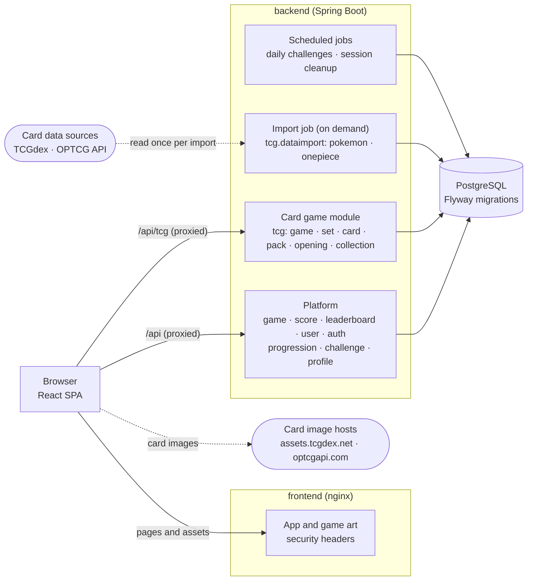

- **Frontend**: a React SPA. Each game is a module behind one small interface (`GameModule`), with its rules in a pure engine that knows nothing of React. The card game is a separate module mounted under `/tcg` and loaded on demand.
- **Backend**: one Spring Boot application, packaged by feature. Features talk to each other through services and DTOs, never through each other's entities, and the card game module is invisible to the rest of the platform.
- **Card data**: imported from external sources into PostgreSQL by a job you run (see [Card games](#card-games)); pack opening, browsing and collections only ever read the database. Card images are loaded by the browser straight from the sources' image hosts.
- **Data**: PostgreSQL, with the schema owned by Flyway migrations and Hibernate set to `validate`.

The full design, including **how to add a new game**, is in [ARCHITECTURE.md](ARCHITECTURE.md). The API is documented in [API.md](API.md).

## Tech stack

| Layer    | Tech |
| -------- | ---- |
| Frontend | React 19, TypeScript, Vite, React Router, TanStack Query, Tailwind CSS 4, Lucide icons |
| Backend  | Java 21, Spring Boot 4 (Web MVC, Security, Data JPA, Validation, Actuator), Hibernate, Flyway |
| Database | PostgreSQL 18 |
| Testing  | Vitest + Testing Library, JUnit, MockMvc, Testcontainers, ArchUnit; coverage with V8 and JaCoCo |
| Tooling  | Docker Compose, nginx, Maven Wrapper, oxlint |

## Getting started

For Neon, Render and Vercel setup, see the [production deployment guide](docs/deployment.md).

### Prerequisites

- **Docker** (Docker Desktop on Windows and macOS). Needed for the stack and for the backend's integration tests.
- For native development: **Java 21** and **Node.js 22+**. Maven is not needed; the repository ships the Maven Wrapper.

### Run everything in Docker

```bash
docker compose up --build
```

Open http://localhost:3000. The first start creates the database, runs the migrations and creates today's daily challenges. The card games are imported once, by a separate run that downloads them and exits (run on demand):

```bash
docker compose run --rm backend --spring.profiles.active=import-tcg
```

`docker-compose.yml` runs three services:

| Service | What it is | Reachable at |
| ------- | ---------- | ------------ |
| `frontend` | nginx serving the built app and proxying `/api` to the backend | http://localhost:3000 |
| `backend` | the Spring Boot API | http://127.0.0.1:8080 (this machine only, for tools) |
| `postgres` | PostgreSQL 18, data in the `db-data` volume | 127.0.0.1:5433 (this machine only) |

### Demo data

A fresh database has the games (and, once imported, the card games) but no players. To fill it the way the screenshots show:

```bash
node tools/demo/seed-demo-data.mjs
```

It plays through the public API: five demo players, games on every leaderboard, and some opened Pokémon and One Piece packs (import the card games first). The server measures game durations; `--packs-only` just opens packs for players who exist already. The demo accounts' password is in the script; it is for local demos only. `node tools/demo/capture-screenshots.mjs` then retakes the screenshots with a headless Chrome.

### Native development (hot reload)

From the repository root, start PostgreSQL. Stockfish installation is optional for the rest of the platform:

```bash
docker compose up -d postgres                  # PostgreSQL on localhost:5433
sh tools/stockfish/install.sh                  # optional, once; Windows: tools/stockfish/install.ps1
```

In a backend terminal, explicitly point the application at the Compose database:

```bash
cd backend
export DB_URL=jdbc:postgresql://localhost:5433/cyan_arcade
./mvnw spring-boot:run                         # API on http://localhost:8080
```

On Windows PowerShell, use `$env:DB_URL = 'jdbc:postgresql://localhost:5433/cyan_arcade'` and `./mvnw.cmd spring-boot:run` instead. Native startup does not load Compose's `.env`; export `DB_USERNAME` and `DB_PASSWORD` too if you changed their defaults. The application's fallback database URL uses port **5435**, so the explicit override above is required for Compose's default port **5433**.

In a separate frontend terminal, from the repository root:

```bash
cd frontend
npm ci
npm run dev                                   # app on http://localhost:5173
```

Import or update the card games against the same database from the backend terminal (with `DB_URL` still set):

```bash
./mvnw spring-boot:run -Dspring-boot.run.profiles=import-tcg
```

Vite proxies `/api` and `/actuator` to the backend, so the browser talks to one origin, as it does through nginx in Docker.

> `backend/src/test/java/com/cyan/arcade/TestCyanArcadeApplication.java` starts the backend against a throwaway Testcontainers database, without Compose.

### Database

- The schema is created and upgraded by **Flyway** when the backend starts (`backend/src/main/resources/db/migration`). There is no manual step.
- An **admin account** is created only when explicitly enabled with credentials (see [Roles](#roles-players-and-admins)).
- The game catalog comes from migrations; the card catalog comes from the card game import (see [Card games](#card-games)).
- To start over with an empty database: `docker compose down -v`, then `docker compose up -d`.
- Login sessions are kept in the backend's memory, so restarting the backend signs everyone out. Accounts, scores, balances, inventory and opening history are persisted in PostgreSQL.

### Configuration

Compose reads these from a `.env` file next to `docker-compose.yml`; [.env.example](.env.example) lists them with their defaults.

| Variable | Default | Meaning |
| -------- | ------- | ------- |
| `DB_NAME`, `DB_USERNAME`, `DB_PASSWORD` | `cyan_arcade`, `cyan`, `cyan` | The database and its credentials |
| `DB_PORT` | `5433` | Host port of PostgreSQL (5433 so it can run next to a local PostgreSQL) |
| `BACKEND_PORT` | `8080` | Host port of the API, bound to 127.0.0.1 |
| `FRONTEND_PORT` | `3000` | Host port of the app |
| `SESSION_COOKIE_SECURE` | `false` | Set to `true` wherever the site is served over HTTPS |
| `CORS_ALLOWED_ORIGINS` | `http://localhost:5173` | Origins allowed to call the API directly from a browser, comma-separated |
| `REGISTRATION_MAX_REQUESTS`, `REGISTRATION_REQUEST_WINDOW` | `5`, `1h` | Registration attempts per client IP |
| `LOGIN_MAX_REQUESTS`, `LOGIN_REQUEST_WINDOW` | `30`, `1m` | All login attempts per client IP, in addition to failed-login throttling |
| `GAME_SESSION_MAX_REQUESTS`, `GAME_SESSION_REQUEST_WINDOW` | `60`, `1m` | Game-session starts per client IP |
| `TCG_DAILY_PACK_LIMIT` | `10` | Card packs a player may open per day (UTC); `0` means no limit. Admins have none |
| `ADMIN_SEED_ENABLED` | `false` | Explicitly opt in to creating an admin at startup; requires both credentials |
| `ADMIN_USERNAME`, `ADMIN_PASSWORD` | unset | Both required when admin seeding is enabled; no default credentials |
| `STOCKFISH_POOL_SIZE`, `STOCKFISH_THREADS`, `STOCKFISH_HASH_MB` | `2`, `1`, `32` | Stockfish processes at most, and search threads and hash memory (MB) each. See [Chess engine](#chess-engine-stockfish) |
| `CHESS_HINTS_PER_GAME` | `3` | Move hints a player gets per chess game (admins: no limit; guests: none) |
| `CHESS_ENGINE_REQUESTS_PER_MINUTE` | `30` | Engine requests (hints, engine moves, evaluations, reviews) one account may make per minute |

The backend reads further settings from environment variables when run natively (or when added to the `backend` service in Compose):

| Variable | Default | Meaning |
| -------- | ------- | ------- |
| `DB_URL` | `jdbc:postgresql://localhost:5435/cyan_arcade` | Native fallback; override to port `5433` for Compose PostgreSQL |
| `SERVER_PORT` | `8080` | Port the API listens on |
| `LOGIN_MAX_FAILURES`, `LOGIN_FAILURE_WINDOW` | `5`, `5m` | Failed logins allowed per username and address, and how long they are remembered |
| `GAME_SESSIONS_ABANDONED_AFTER` | `24h` | How long a started game may stay unfinished before the hourly cleanup removes it |
| `SCHEDULING_ENABLED` | `true` | Switches every scheduled job on or off |
| `DAILY_CHALLENGES_GENERATION_ENABLED` | `true` | Creates each day's challenges at startup and at midnight UTC |
| `REWARDS_GAME_COMPLETED_COINS`, `REWARDS_PERSONAL_BEST_COINS` | `5`, `15` | Coins for finishing a game, and extra for beating your own best |
| `REWARDS_GAMES_PER_DAY` | `40` | How many games a day (UTC) pay the coins for finishing; later ones still earn XP and best-score coins |
| `REWARDS_PERSONAL_BESTS_PER_DAY` | `10` | How many new personal bests a day (UTC) pay the best-score coins; later ones still earn their XP |
| `DAILY_LOGIN_REWARDS` | `50,60,70,80,100,125,200` | Coins for each day in a row of the daily login reward; then it starts over |
| `DAILY_LOGIN_BONUS_ITEM` | `EXTRA_PACK` | The shop item given on top on the last day (empty for none) |
| `TCG_IMPORT_SOURCES` | empty (`pokemon,one-piece` in the `import-tcg` profile) | Card game sources to import at startup. An ordinary start imports nothing |
| `TCG_IMPORT_FILES` | empty | Comma-separated paths of card game datasets (the arcade's own JSON format) to import at startup |
| `TCG_POKEMON_URL`, `TCG_POKEMON_CONFIG` | TCGdex's GraphQL API, `classpath:tcg/sources/pokemon.json` | Where Pokémon data comes from, and which sets and pack layouts to use |
| `TCG_ONE_PIECE_URL`, `TCG_ONE_PIECE_CONFIG` | `https://optcgapi.com/api`, `classpath:tcg/sources/one-piece.json` | The same for One Piece |

**Request limits and reverse proxies.** The three POST limits above use separate, atomic fixed
windows starting at the first request. They return `429` problem details with code
`RATE_LIMIT_EXCEEDED` and a `Retry-After` header. Only CSRF-verified requests are counted;
logout, session restoration (`GET /api/auth/session`) and finishing a game remain available.
Counters are in memory, reset on restart, and track at most 10,000 route/IP pairs. When full,
new pairs are refused until capacity expires. Players sharing an IP share each route's budget.

Client addresses come from the socket (`getRemoteAddr()`); arbitrary `Forwarded` or
`X-Forwarded-For` headers are ignored by default. The supplied nginx overwrites `X-Forwarded-For`
with its peer address, clears untrusted host/forwarding headers, and preserves the public Host port.
Since Compose proxy IPs can change, **no proxy
address is trusted automatically**. Behind nginx, users therefore share its apparent address
until the deployment is explicitly configured:

- Keep the backend private and identify the actual nginx peer IP(s) seen by the backend.
- Set `SERVER_FORWARD_HEADERS_STRATEGY=native` and `TRUSTED_PROXY_REGEX` to a pattern matching
  only those addresses. The default pattern `(?!)` trusts none, even with native handling enabled.
  Both settings can be supplied through Compose's `.env`. Avoid broad private-network patterns
  or `framework` forwarding, which bypasses peer validation.
- If another load balancer/CDN precedes nginx, configure its trust boundary separately; do not
  forward a client-provided chain or guess its trusted addresses. Recheck trust after network changes.

Frontend build and dev settings:

| Variable | Default | Used by |
| -------- | ------- | ------- |
| `API_PROXY_TARGET` | `http://localhost:8080` | The Vite dev server's proxy |
| `VITE_API_BASE_URL` | empty (same origin) | Browser code, to call the backend directly instead of through a proxy |

## Roles: players and admins

Every account has exactly one role. Signing up always makes a **USER**; **ADMIN** accounts are created only through explicitly enabled seeding.

| | USER (player) | ADMIN |
| --- | --- | --- |
| Play the games, scores, leaderboards, XP, achievements, daily challenges | ✅ | ✅ |
| Collect cards, opening history | ✅ | ✅ |
| Card packs | 10 a day (`TCG_DAILY_PACK_LIMIT`) | **No daily limit** |
| **AI mode** (Snake, 2048, Tetris play themselves) | ❌ | ✅ |
| Chess move hints from Stockfish (guests: none) | 3 a game, counted on the server | **No limit** (within the rate limit) |
| Chess against Stockfish, evaluations, game reviews | ❌ | ✅ |
| Admin page (`/admin`) | ❌ | ✅ |

**Optional admin account**

Admin seeding is disabled by default. For local Docker development, copy `.env.example` to `.env`,
set `ADMIN_SEED_ENABLED=true`, and fill in `ADMIN_USERNAME` and `ADMIN_PASSWORD` with your own
credentials before starting the stack. The ignored `.env` file is read by Docker Compose; for native
development, export those same three environment variables before starting the backend.
There is no default username or password. Enabling seeding with either credential missing or blank
fails startup without creating an account. After creation, set `ADMIN_SEED_ENABLED=false` and remove
the seeding credentials from your environment; the account remains available.

- **Seeding**: at startup, if no account has the admin username, one is created with the ADMIN role and the password hashed by the same bcrypt encoder as every other password. Otherwise nothing happens: restarting creates no duplicate, never resets the password, and never promotes a player who registered that name first (it logs a warning instead). The password is never logged. Changing `ADMIN_PASSWORD` later does not change an account that already exists.
- **How it is enforced**: the role is stored with the account (`users.role`) and becomes the session's Spring Security authority, `ROLE_USER` or `ROLE_ADMIN`, when the player signs in. Admin-only endpoints (`/api/admin/**`, `/api/ai/**`) require `ROLE_ADMIN` in the security configuration and again with `@PreAuthorize("hasRole('ADMIN')")` on their controllers; a player gets `403`, a guest `401`. Nothing checks a username.
- **AI mode**: the games' AIs run in the browser, so what is protected is the AI itself. The app loads a game's AI only after `GET /api/ai/access` succeeds, and the AI's code is built into separate files (`/assets/ai/`) that nginx serves only when that same check passes for the request's session. A player sees no AI switch and cannot download the AI by its address either. (The Vite dev server does not have that last check.)
- **Packs**: the daily allowance is checked in one place, the pack opening itself, which skips it for ROLE_ADMIN. Admins open packs through exactly the same code otherwise, so collections and histories work the same.
- **The UI follows the role** (an Admin button in the header, the AI switch, "Unlimited packs · Admin"), but only as a convenience: the server decides.
- A role is read when the player signs in, so a role change takes effect at their next sign-in.

## Chess engine (Stockfish)

Chess integrates [Stockfish 19](https://stockfishchess.org/) over UCI as separate backend processes. A bounded process pool, request limits, timeouts and an analysis cache control engine use.

- **Installation:** Docker downloads a pinned release and verifies its SHA-256 during the image build. Native development uses the [install scripts and instructions](tools/stockfish/README.md). The engine is GPL-3.0; see [third-party notices](THIRD_PARTY_NOTICES.md) for licence and source availability.
- **Access:** signed-in players get move hints and Coach Mode; admins also get engine games, position analysis and finished-game reviews. Authorization is enforced by the backend.
- **Availability:** the rest of the platform runs without the binary; engine requests return `503 ENGINE_UNAVAILABLE` when it is absent. Real-engine tests are conditional on its installation; scripted tests cover the protocol separately.

See the [Chess architecture](ARCHITECTURE.md#chess) for rules, ownership, revisions, engine lifecycle and analysis details.

## Economy: coins, rewards and the shop

Coins are the platform's currency. Players earn them by playing and spend them in the shop; nothing about them is real money.

| Earned by | Coins | Paid once per |
| --- | --- | --- |
| Finishing a game | 5 (the first 40 games of a day) | game session |
| Beating your own best in a game | 15 | game session |
| Unlocking an achievement | 100 to 500 (set per achievement) | achievement |
| Completing a daily challenge | 40 to 120 (set per challenge) | challenge |
| Daily login reward | 50, 60, 70, 80, 100, 125, 200 (+ a free pack) | day |
| An admin's grant | 1 to 100,000, with a reason | request |

- **The server decides every amount.** Player requests do not choose reward amounts; the client says what happened (a game finished, today's reward claimed, this item bought) and the server applies its own rules.
- **A ledger, not just a number.** Every change is a row in `coin_transactions` (amount, balance after, type, what it refers to, description, and for grants the admin who made them). The balance in `user_wallets` is kept next to it for quick reads and is always the sum of the ledger.
- **Nothing is paid twice.** Each reward refers to what it rewards (the game session, the achievement, the challenge, the day), and a unique index allows one transaction per player, type and reference: a repeated or replayed request finds the first and pays nothing.
- **Nothing goes below zero.** Every change locks the player's wallet row first, so changes to one balance happen one at a time; spending more than the balance fails and changes nothing, and the database refuses a negative balance anyway.
- **All or nothing.** A reward is paid in the same transaction as what earned it (the score, the claim, the challenge); if anything fails, all of it is rolled back.
- **The day is the server's, in UTC**, for the daily login reward as for challenges and the pack allowance. The client's date is never asked for.

**The shop** sells extra card packs (consumable: opened once the daily allowance is gone, from any booster, and bought as often as you like) and badges, titles and profile frames (owned once and equipped on the profile, one of each, visible on the public profile). Some items need a level (the level system's unlocks). A purchase names the item and a random request id: the server checks the level, what you already own and your balance, takes the price and hands the item over in one transaction, and the same request id never buys twice. What an item does is decided by a handler for its type (`PACK`, `BADGE`, `TITLE`, `COSMETIC`, `GAME_SKIN`), so a new kind of item is a new handler, not a change to the shop. Game skins belong to a game and a slot (Flappy Bird's `bird`, `pipes` and `sky`; Brick Breaker's `paddle`, `ball` and `bricks`; Word Guess's `tiles` and `keyboard`; Sudoku's `board` and `pad`; Dino Run's `runner` and `obstacles`): one is worn per slot, wearing none means the game's own free look, and the game draws them itself, in the game and in the shop.

**Admins** keep their unlimited card packs and never use bought ones. They can give a player coins from the admin page: between 1 and 100,000, with a reason, recorded in the player's ledger as an `ADMIN_GRANT` with who gave them.

## Card games

The arcade carries two real trading card games. Their data is **imported** into PostgreSQL from public sources; browsing and pack opening use the local catalog, while external data APIs are used only by imports.

```text
External source ──(import job, on demand)──▶ PostgreSQL ──▶ Cyan Arcade (browsing, packs, collections)
```

| Game | Source | What is imported | Images |
| ---- | ------ | ---------------- | ------ |
| Pokémon TCG | [TCGdex](https://tcgdex.dev) GraphQL API: open source, free, no key | Configured sets and cards, with rarities, set logos and release dates | `assets.tcgdex.net`, in two sizes: small for grids, large for a closer look and pack openings |
| One Piece Card Game | [OPTCG API](https://optcgapi.com): a free, fan-run public API for the English game | Configured sets and cards, including alternate-art printings and game-specific rarity data | `optcgapi.com`, one size |

- **Run it** with the `import-tcg` profile (commands above); `TCG_IMPORT_SOURCES=pokemon` imports one game. Import duration depends on the configured catalog and source availability.
- **Repeatable and idempotent**: every card is keyed by its source's id (`sv01-001`, `OP01-120_p1`), so running it again adds what is new, updates what changed and duplicates nothing; the log says, per game, how many cards were new, updated and unchanged, and names any set or cards skipped (a card the source has no image for is never given one). Nothing is deleted, because collections and opening histories point at cards. The whole game is one transaction: a failed run writes nothing.
- **Configurable**: which sets to take, what each source rarity is called and how rare it is, and how each kind of pack is made up live in `backend/src/main/resources/tcg/sources/*.json`, not in code.
- **Pack odds are simulator probabilities.** Neither The Pokémon Company nor Bandai publishes official pull rates, so each pack layout is this arcade's approximation, and every pack says so on its page.
- **Adding another card game** means one new source (a client and a mapper to the generic dataset format) and a configuration file; the tables, the API and the pages stay as they are. A game with no API can also be imported from a dataset file (`TCG_IMPORT_FILES`).

**Licensing and usage.** Card names, text and images are © their publishers (Nintendo, Creatures, GAME FREAK and The Pokémon Company; Eiichiro Oda/Shueisha, Toei Animation and Bandai). TCGdex and OPTCG API are community projects, not official sources. Cyan Arcade is a non-commercial fan and portfolio project, not affiliated with or endorsed by any of them, and says so on every card game page. Card images are not copied into this repository; the browser loads them from the sources' hosts, so they appear only while those hosts serve them.

**Coverage, checked on 2026-10-15.** Pokémon: every main and special expansion of Scarlet & Violet and Mega Evolution through Pitch Black, and the **30th Celebration** (TCGdex `30th`: 158 cards, the 128 numbered ones and 30 secret rares, with the 30 Pikachu Rares 023–052 and the two Futuristic Rares as separate cards). Its pack follows the published contents (five foil cards, a Pikachu Rare in every pack); the other weights are game balance. Not imported: the **30th Classic Collection** (TCGdex lists its 30 reprints without images or rarities), the Black Star promos and older eras not configured. One Piece: every booster and extra booster OPTCG API lists from OP-01 to OP-17 and EB-01 to EB-03. Not imported: the **Premium Boosters PRB-01 and PRB-02**, which are reprint compilations whose cards OPTCG API lists under the original sets' ids (importing them would move prints into those sets), and OP-18 and EB-05, not yet released.

**Data limitations.** TCGdex does not tell holo rares from other rares in the classic sets. OPTCG API marks alternate arts in the card name ("(Parallel)", "(Manga)"), which the import turns into rarities; a few alternate arts it lists under the base card's id get a derived id (`OP14-074-dash-pack`). One Piece images are the official preview images, with a "SAMPLE" mark. Release dates are known for Pokémon sets only.

## Testing

**Backend CI** is configured to run Maven `verify` on Java 21 for pushes to `main` and pull requests targeting `main`. PostgreSQL integration tests use Testcontainers with the GitHub-hosted Linux runner's Docker daemon; no database secrets or separate service are required. The workflow caches Maven dependencies and attempts to upload `backend-reports` even on failure, retaining available Surefire/Failsafe and JaCoCo reports for 14 days. Coverage reports may be absent if verification stops before JaCoCo's report goal.

Run locally:

```bash
cd backend
./mvnw verify                             # requires Docker for PostgreSQL Testcontainers
```

From the repository root, in a separate terminal:

```bash
cd frontend
npm ci
npm run typecheck
npm run lint
npm test
npm run coverage
npm run build
```

| Report | Local output |
| --- | --- |
| Backend test results | `backend/target/surefire-reports/` |
| Backend coverage | `backend/target/site/jacoco/index.html` |
| Frontend coverage | `frontend/coverage/index.html` |

- **HTTP and database behavior:** MockMvc with a real PostgreSQL Testcontainers database and Flyway migrations, covering authentication, scores, rewards, purchases, packs, collections and profiles.
- **Failure and concurrency cases:** simultaneous spending, duplicate score submissions, retried purchases/openings, allowance limits and rollback after partial failure. Rate-limit and trusted-proxy checks also have focused tests without a database.
- **Architecture:** ArchUnit checks module dependencies, persistence encapsulation and password-handling boundaries.
- **Frontend:** game engines, pages, input behavior, opening/retry flows and module boundaries.

Useful backend entry points: [purchase concurrency tests](backend/src/test/java/com/cyan/arcade/shop/ShopApiTests.java), [pack-opening tests](backend/src/test/java/com/cyan/arcade/tcg/PackOpeningApiTests.java), [security-chain tests](backend/src/test/java/com/cyan/arcade/common/security/RequestRateLimitSecurityTests.java), and [architecture rules](backend/src/test/java/com/cyan/arcade/ArchitectureTests.java). For executed results, use the [Actions runs and artifacts](https://github.com/trannguyendangtam1111/cyan-arcade/actions/workflows/backend-ci.yml).

## Project layout

```text
.
├── .github/workflows/        # backend Maven verification and report artifacts
├── docker-compose.yml        # postgres + backend + frontend
├── .env.example              # settings for docker compose
├── backend/                  # Spring Boot modular monolith, packaged by feature
│   └── src/main/
│       ├── java/com/cyan/arcade/
│       │   ├── common/       # errors, security, time, scheduling
│       │   ├── game/  score/  leaderboard/          # catalog, score submission, rankings
│       │   ├── user/  auth/  profile/               # accounts, sign-in, the player's own data
│       │   ├── progression/  challenge/             # XP, levels, achievements, daily challenges
│       │   ├── economy/  dailylogin/  shop/          # coins and their ledger, the daily login reward, the shop
│       │   ├── admin/        # admin dashboard, coin grants, AI access
│       │   ├── chess/  sudoku/  wordle/              # games played on the server, each a module of its own
│       │   └── tcg/          # the card game module: game, set, card, pack, opening, collection, dataimport
│       └── resources/
│           ├── db/migration/     # versioned Flyway migrations
│           └── tcg/sources/      # which sets to import, rarities and pack layouts, per card game
├── frontend/                 # React + Vite SPA, served by nginx in Docker
│   ├── nginx/                # nginx configuration and security headers
│   ├── public/               # favicon and game thumbnails
│   └── src/
│       ├── app/  api/  components/  hooks/  layouts/  pages/  lib/  styles/
│       ├── games/            # shared/ plus snake/, 2048/, tetris/: engine, ai, hooks, components
│       └── tcg/              # the card game module: api, pages, pack opening, components
├── tools/
│   ├── demo/                 # demo data and screenshots
│   └── stockfish/            # pinned Stockfish install scripts, version, checksums, licence notes
└── docs/screenshots/
```

## Roadmap

### Implemented

- Modular backend, shared game catalog, scored sessions, leaderboards and player profiles.
- Spring Security authentication/authorization, explicit admin seeding, request limits and trusted-proxy configuration.
- Transactional coins, progression, daily rewards/challenges, purchases, inventory and audited admin grants.
- Imported card catalogs, server-side pack opening, idempotent request replay, collections and history.
- Arcade games, server-played Word Guess/Sudoku, local Chess and Stockfish integration.
- Docker/nginx configuration, automated tests and a backend GitHub Actions workflow.

### Planned

- Hosted deployment with HTTPS.
- Login sessions that survive a backend restart, using Spring Session.
- Email/password recovery.
- Online Chess between accounts, with ownership, matchmaking/invitations and real-time updates; see [design notes](ARCHITECTURE.md#online-chess-later).
- Additional games such as Memory and Connect Four, after backend reliability work.

### Current limitations

- **Single-instance state:** login sessions and rate-limit counters are in memory and reset on restart. Users sharing an IP share request budgets; proxy trust must be configured for the actual deployment.
- **Client trust:** browser-game scores are checked for consistency and plausible timing, not replayed from every input. Word Guess and Sudoku keep their answers on the server, but automation is still possible; Sudoku also trusts the browser to hide the board while paused. Coins from scored browser games inherit these limits.
- **Retry compatibility:** legacy pack-opening calls without an `Idempotency-Key` remain supported and open a new pack on each call. The frontend sends stable keys; successful replay snapshots are retained without automatic expiry.
- **Account management:** no password reset or role-management page yet. Guest scores are not reassigned after registration; admin credentials are used only for optional creation and do not reset existing accounts.
- **External assets:** card images depend on their source hosts. Import data availability and catalog contents depend on the configured sources and import run.
